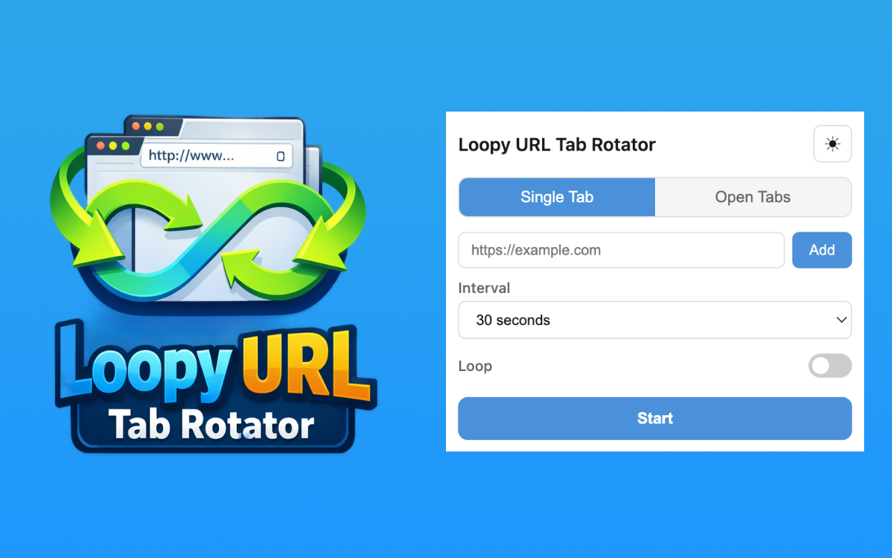

# Loopy URL Tab Rotator

A browser extension that rotates through a list of URLs, or through your open tabs, on a timer. Useful for dashboards, kiosks, status screens and presentations.



## Install

| Browser | Link |
|---------|------|
| Chrome | [Chrome Web Store](https://chromewebstore.google.com/detail/loopy-url-tab-rotator/jliigbabikjgiebnalhhmadjhdehfnmg) |
| Firefox | [Firefox Add-ons](https://addons.mozilla.org/en-US/firefox/addon/loopy-url-tab-rotator/) |
| Opera | Coming soon |
| Safari | Coming soon |

Edge can install the Chrome Web Store version, or you can [build it from source](#build-from-source).

## Features

- **Single Tab mode:** loads each URL from your list in the same tab, in order.
- **Open Tabs mode:** cycles through the tabs open in the current window, with optional reload on switch.
- Preset intervals from 5 seconds to 10 minutes, or a custom interval in seconds.
- Loop forever or a set number of times.
- Drag and drop to reorder URLs.
- Light and dark theme.
- Settings are saved automatically, and a running rotation resumes after the browser suspends the extension.

## Permissions

| Permission | Why |
|------------|-----|
| `tabs` | Load URLs in the rotation tab, switch between open tabs and show the current tab title. |
| `storage` | Save your settings and the rotation progress on your device. |
| `alarms` | Run a watchdog that restarts the rotation if the browser suspends the background script. |
| `offscreen` (Chromium) | Keep an accurate timer running in an offscreen document. |
| `scripting` (Firefox) | Try to inject a small keep-alive script for the background script. |

The extension requests no host permissions and cannot read page content.

## Privacy

Loopy URL Tab Rotator collects no data and makes no network requests of its own. Your URL list and settings stay in your browser's local storage. The only pages it loads are the ones you add.

## Build from source

Requirements:

- Node.js 20 or newer
- The `zip` command
- Xcode on macOS, for the Safari build only

There are no npm dependencies, so there is nothing to install.

```sh
npm run build
```

This builds every browser into `dist/<browser>/`. Safari is built only on macOS with Xcode installed; otherwise it is skipped with a message. To build a single browser:

```sh
npm run build:chrome
npm run build:firefox
npm run build:edge
npm run build:opera
npm run build:safari
```

### Load the unpacked build

- **Chrome:** open `chrome://extensions`, turn on Developer mode, click **Load unpacked** and pick `dist/chrome`.
- **Edge:** open `edge://extensions`, turn on Developer mode, click **Load unpacked** and pick `dist/edge`.
- **Opera:** open `opera://extensions`, turn on Developer mode, click **Load unpacked** and pick `dist/opera`.
- **Firefox:** open `about:debugging#/runtime/this-firefox`, click **Load Temporary Add-on** and pick `dist/firefox/manifest.json`.
- **Safari:** open `dist/safari-xcode/Loopy URL Tab Rotator/Loopy URL Tab Rotator.xcodeproj` in Xcode, run the app, then enable the extension in Safari settings. Unsigned extensions need **Allow unsigned extensions** in Safari's Develop menu.

## Releasing

1. Set the new version in `package.json`.
2. Run `npm run release`. It syncs the version into both manifests, builds every target and writes the store packages to `packages/loopy-<browser>-<version>.zip`.
3. Upload each zip to its store: Chrome Web Store Developer Dashboard, Firefox Add-ons Developer Hub, Microsoft Edge Add-ons and Opera Add-ons.
4. For Safari, archive the Xcode project in `dist/safari-xcode/` and submit it through App Store Connect.
5. Tag the release in git and attach the zips to the GitHub release.

## Architecture

See [ARCHITECTURE.md](ARCHITECTURE.md) for the project layout, rotation timers, storage and message flow.

## License

[MIT](LICENSE)
